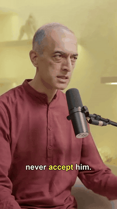
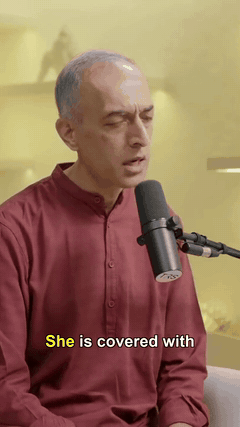

# PodClipper

**Give it a podcast. Get vertical reels with captions.**

PodClipper transcribes your video, picks and reviews useful moments, follows the
speakers in a 9:16 crop, and exports captioned MP4s. One command runs the whole
podcast-to-reels flow.

```bash
podclipper "podcast.mp4"
```

Video and audio processing run locally by default. Experimental `--scribe`
uploads audio for hosted transcription. One configured, vision-capable LLM
endpoint handles clip selection, title review, caption correction, content
scoring, and source-shot review. Transcripts and representative source frames
are sent to that endpoint.

[Watch the demo](https://podclipper.loukik.dev)

## Get started

### 1. Install

**Apple Silicon Mac, macOS 14 or newer:** one command installs PodClipper,
Python 3.12, and FFmpeg:

```bash
brew install loukiknaik/tap/podclipper
```

Upgrade with `brew update && brew upgrade podclipper`.

**Other platforms or an existing Python environment:** use **Python 3.10–3.12**
and install FFmpeg (which includes `ffprobe`):

```bash
# macOS
brew install ffmpeg
# Ubuntu / Debian
sudo apt install ffmpeg
```

Inside an activated virtual environment, install the published package:

```bash
pip install podclipper
```

Alternatively, pipx manages the virtual environment for you. For example, on macOS:

```bash
brew install ffmpeg pipx python@3.12
pipx ensurepath
pipx install --python python3.12 podclipper
```

Reopen your terminal if `pipx ensurepath` asks you to. Upgrade later with
`pipx upgrade podclipper`.

<details>
<summary>Developing locally? Install from source</summary>

```bash
git clone https://github.com/LoukikNaik/PodClipper.git
cd PodClipper
python3 -m venv .venv
source .venv/bin/activate
pip install -e .
```

</details>

### 2. Set your API key once

```bash
podclipper init
```

This creates a small `podclipper.yaml` and a `.env` file. Existing files are kept.
The starter config uses the OpenAI endpoint; put your key in `.env`:

```dotenv
LLM_API_KEY=your-api-key
```

The same `LLM_API_KEY` name works for every supported host. Already using another
OpenAI-compatible endpoint? Set its endpoint and model in `.env` or
`podclipper.yaml`. See [LLM configuration](#llm-configuration).

### 3. Make reels

```bash
podclipper "path/to/podcast.mp4"
```

That's the full flow. Podcast mode, vertical cropping, and classic captions
are already enabled. The CLI automatically reads `podclipper.yaml` and `.env`
from your working directory. No `-c` or extra mode flags are needed.

The first run downloads the local transcription and detection models. Those
models are reused on later runs. Processing can take a while, especially on CPU.

Finished clips appear in a new folder:

```text
outputs/<timestamp>/
  reel_01_<title>.mp4
  reel_01_<title>.txt
  reel_02_<title>.mp4
  reel_02_<title>.txt
```

MP4s are vertical **1080 × 1920** with audio and burned-in captions. Text
sidecars contain source timestamps, selection reasons, and review scores.
The CLI prints the saved file paths when it finishes. It aims for the configured
clip count; it may export fewer when candidates are rejected or processing fails.

For podcasts with edited split screens, the cropper detects thin light/dark
vertical divider lines and keeps each crop inside its source panel. It shows at
most two views, resets framing when the panel layout changes, and excludes the
divider itself. Stacked views fill the frame. Detected camera and column changes reset
tracking to a fresh crop, even for the same person, with a 0.24-second crossfade and
no added zoom animation. Advanced overrides are under `crop.panel_dividers` and
`crop.scene_cuts`; set `crop.scene_cuts.crossfade_seconds: 0` for hard cuts.
Choosing views uses visible person size, not active-speaker
identification. Faint, broken, or decorative dividers may not be recognized.

Before cropping, a local cut detector splits each selected clip into source
shots, including abrupt cuts and short dissolves. The same LLM reviews up to
three sample frames per shot and classifies it as speaker, audience, other,
or uncertain. Up to three shots share a request, and successful decisions are
cached in the clip's `scenes.json`; there is no LLM call per video frame.
Audience, contextual, and uncertain shots retain the entire source picture
on a blurred background that fills the vertical canvas. Speaker framing starts
fresh at the next speaker shot. Missed cuts and ambiguous compositions remain
limitations, so this is not a guarantee of perfect scene classification.

Local YuNet face detection and SFace recognition keep background people out
of the speaker candidates and require distinct faces before stacking. The
renderer also checks that each intended face remains visible in its actual
crop; duplicate or unverifiable stacked views fall back to one view. No
names or face database are needed, and recognition features stay in memory.
The approximately 39 MB of face models download on first use and are reused
from `~/.cache/podclipper/models/`. Internal overrides live under
`crop.face_identity` and `crop.scene_review`, without expanding the starter
config. A model without image support cannot classify shots: failed vision
requests retain full-source framing and are retried on the next render.
Within a continuous speaker shot, single-face framing holds the selected
person while their body box still matches. Required subject/layout changes
crossfade instead of snapping between crops.

Normal transcription behavior is unchanged. For a targeted retry, internal
overrides can set `transcribe.language`, `transcribe.vad_filter`, and
`transcribe.second_pass.task` (`transcribe` or English `translate`),
`beam_size`, and a short `initial_prompt` vocabulary hint. These settings
invalidate only the affected transcription/cleanup cache, preserving the crop.
Translation word timings are approximate and still require coverage and
caption review before posting.

## Everyday commands

```bash
# Run everything, asking for three clips
podclipper podcast.mp4 --clips 3

# Use pop captions instead of classic karaoke captions
podclipper podcast.mp4 --captions pop

# Choose an output location
podclipper podcast.mp4 --output-dir outputs/my-podcast
```

### Want to review the picks before exporting?

```bash
podclipper podcast.mp4 --clips 3 --select-only
```

Read `outputs/<timestamp>/selection.md` for titles, source timestamps, full
transcript excerpts, and the opening and ending of each clip. No reels are
rendered yet. A matching `selection.json` is saved alongside it.

Then export those exact picks:

```bash
podclipper podcast.mp4 --selection outputs/<timestamp>/selection.json
```

Use the same source video. Saved titles, order, and cut boundaries are preserved;
per-clip transcription, cropping, captions, and evaluation still run normally.

### Experimental: transcribe once with Scribe

With an OpenRouter connection already set in `.env`, opt in per run:

```bash
podclipper podcast.mp4 --scribe --clips 3
```

Scribe v2 transcribes the source in resumable overlapping chunks. The LLM
selects clips from that transcript, and captions reuse the same word timestamps;
the normal per-clip Whisper pass is skipped. Captions follow the selected cut
bounds, excluding neighboring words in the extraction buffer. Speech-coverage checks still run
and retry only problematic sections with Scribe. Caption cleanup/romanization,
framing, and export remain unchanged. Scribe produces transcription, not English
translation of all Hindi speech.

This uploads audio to OpenRouter/ElevenLabs and incurs transcription charges.
It uses the same `LLM_ENDPOINT=https://openrouter.ai/api/v1` and `LLM_API_KEY`;
your shared `LLM_MODEL` still handles selection and cleanup. No extra credentials
are needed. Whisper remains the default when the flag is omitted.

`--scribe` also works with `--select-only` and `--selection`; pass it on both
commands to reuse the full transcript when exporting saved picks. `--limit-minutes`
limits source transcription too. Successful chunks are cached separately from
Whisper and resumed on rerun; `--no-cache` repeats paid requests.

Advanced config can enable it with `transcribe.scribe.enabled: true` and override
`chunk_seconds` (10–300), `overlap_seconds`, `timeout_seconds`, and `max_attempts`.
These options are omitted from the minimal starter config.

Full-source chunks can use up to 64 section repairs (`source_repair_max_windows`).
If small speech gaps remain, podcast and comedy selection excludes them with
surrounding context and keeps successful repairs. Processing still stops when
unresolved speech exceeds 5% of a source chunk (`max_unreliable_fraction`);
set that limit to zero to require complete source coverage. Exported reel
captions must still pass the strict coverage checks.

See [the transcription experiments](docs/experiments/openrouter-transcription.md)
for quality observations, pricing, and limitations.

## Small config, sensible defaults

The starter config contains only the settings most people need:

```yaml
llm:
  endpoint: https://api.openai.com/v1
  model: gpt-5-mini
content:
  clips: 8
output:
  captions: classic
```

Change `content.clips` to ask for fewer or more clips. Captions can be `classic`,
`pop`, or `off`. Optional settings include `content.duration: [15, 90]` (seconds)
and `output.directory: outputs`.

Omitted settings inherit the packaged defaults. You can still override internal
settings without copying the whole default config—for example:

```yaml
crop:
  stacked_transition_frames: 24
```

Config loading order is packaged defaults → explicit `-c` file **or** local
`podclipper.yaml` → environment overrides → CLI flags. Nested mappings merge; lists and scalar values
replace defaults. Explicit internal settings take precedence over their public
shortcuts. Unknown settings and invalid value types produce an error.

```bash
# See the effective config, including inherited defaults
podclipper config --resolved

# Use a different config (and load its sibling .env as a fallback)
podclipper podcast.mp4 -c another-config.yaml
```

`LLM_ENDPOINT` and `LLM_MODEL` in your environment override YAML settings.
Blank endpoint/model variables leave the YAML values in place.
Shell environment variables take precedence over `.env`; the working-directory
`.env` takes precedence over a config file's sibling `.env`. Keep API keys in
`.env` or your shell, rather than the YAML file.

### LLM configuration

Every LLM stage uses the same OpenAI-compatible endpoint through LiteLLM.
There is no Claude CLI dependency or reasoning-effort override.

Use one host, one model, and one key. For example, our OpenRouter setup can be
configured entirely in `.env`:

```dotenv
LLM_ENDPOINT=https://openrouter.ai/api/v1
LLM_MODEL=z-ai/glm-5.3-flash
LLM_API_KEY=your-api-key
```

Or keep the endpoint and model in YAML and only `LLM_API_KEY` in `.env`:

```yaml
llm:
  endpoint: https://openrouter.ai/api/v1
  model: z-ai/glm-5.3-flash
```

There are no provider-specific key variables or `api_key_env` setting. Existing
setups should rename their API key variable to `LLM_API_KEY` and remove
`llm.api_key_env` from YAML. Optional provider routing:

```yaml
llm:
  routing:
    order: [deepinfra]
    allow_fallbacks: true
```

This prefers DeepInfra while allowing other hosts. `only: [deepinfra]` restricts
requests to that host. Model and provider availability depend on your endpoint.

LLM calls default to `llm.max_tokens: 32768` (32k). Incomplete responses are
never accepted. The retry ceiling also defaults to 32k, so a truncated response
at that limit fails. To allow **one** larger retry, raise `llm.retry_max_tokens`
above `max_tokens`; the retry uses up to twice the requested budget, capped by
that ceiling. A retry can increase API cost, and your endpoint must support the
larger budget. These settings are optional overrides; they don't need to appear
in the minimal config.

## What happens under the hood

1. Validate the video and extract audio.
2. Transcribe the podcast locally with Whisper.
3. Ask the LLM for clips, refine their boundaries, and review each cut and title.
4. For each accepted clip, detect speakers and transcribe again for caption timing.
   Check local speech coverage against the audio and available first-pass words,
   then retry suspicious sections with surrounding context. Cached captions get
   the same checks. Unresolved gaps stop that clip before export; the default
   cache saves retry details in `words.quality.json`.
5. Correct caption words, crop to 9:16, and burn in captions and the title.
6. Export the MP4 and a content scorecard.

Selection checks for an understandable opening, a complete ending, supported
titles, valid duration, and overlapping clips. Overlong titles get one shortening
retry. Review decisions are saved in the analysis cache's `04_final.json`.

Caption correction can join wrongly split words or split wrongly joined words.
Original word indices stay attached; split timing is estimated within the original
word span. Invalid corrections preserve the original transcript.

## Troubleshooting and advanced options

- **Missing API key or FFmpeg:** the CLI checks these before transcription and
  tells you what to set or install. This checks key presence, not whether the
  endpoint will accept the key or whether your account has credit.
- **Config error:** fix the named setting in `podclipper.yaml`. Use
  `podclipper config --resolved` to see inherited defaults.
- **Need details about a failure?** Add `--verbose`.
- **First run is slow:** model downloads and local video processing take time.
- **Rerunning:** intermediate audio, transcripts, and clips are cached in `.cache/`.
  Stages may still run again; this isn't a resume from the exact point of failure.
  Use `--no-cache` to rebuild intermediates.

```bash
podclipper --help        # everyday podcast options
podclipper --help-all    # all options, including advanced and other modes
```

The default transcription engine is faster-whisper (CPU/CUDA), using `base`
for initial transcription and `large-v3` per clip. Apple Silicon users can opt
into `--whisper-engine mlx`; it falls back to faster-whisper if unavailable.
Whisper, YOLO, and MediaPipe models download automatically on first use.

### Stand-up comedy

Use the same setup and API key with a downloaded stand-up set:

```bash
podclipper standup.mp4 --type comedy --clips 3
# Optional API transcription instead of local Whisper
podclipper standup.mp4 --type comedy --scribe --clips 3
```

Comedy mode selects complete jokes with their setup and punchline, uses a
comedy rubric for review, and keeps a single performer crop. Audience shots
keep the source composition. A short non-speech tail preserves some reaction
before the next spoken line; override `analyze.comedy_reaction_seconds` in YAML
(default: 2 seconds). Review delivery, captions, and joke boundaries before
posting: transcript review cannot judge whether a performance is funny.
If the source already has burned-in captions, use a clean source or remove
its caption border before running; PodClipper does not automatically erase
existing subtitles.
With `--scribe`, comedy mode also detects laughter/applause events. These do
not become caption words, and confirmed gaps between spoken words are excluded
from missing-speech checks. Internal override: `transcribe.scribe.tag_audio_events`.
The source-gap exclusion and strict final-caption checks described above also
apply to comedy mode.

Trailer options remain available under advanced help.

Full defaults: [src/podclipper/config/default.yaml](src/podclipper/config/default.yaml).
Developer notes: [CLAUDE.md](CLAUDE.md). Local crop iteration:

```bash
python dev/regen_crops.py .cache/<video_stem>-<hash> outputs/regen_run sidecar_dir/
```

### Current limitations

Review exports before posting. Clip selection uses transcript text; it can miss
visual moments or choose a cut that needs more context. Content scores aren't
an audiovisual quality check or an independent fact check.

The latest full run also exposed occasional duplicate speaker panels and titles
covering faces. Those crop/layout issues are still outstanding.

## Demo reels

Three reels generated end-to-end from a single ~60-minute podcast episode. Previews loop silently below — **click any tile to open the full MP4 with audio.**

<table>
  <tr>
    <td align="center" width="33%">
      <a href="https://github.com/LoukikNaik/PodClipper/releases/download/demo-assets-v1/reel_01_confidence-is-an-output-not-input.mp4">
        
      </a>
      <br/><em>"Confidence Is an Output, Not Input"</em>
      <br/><sub><a href="https://github.com/LoukikNaik/PodClipper/releases/download/demo-assets-v1/reel_01_confidence-is-an-output-not-input.mp4">▶ play with audio</a></sub>
    </td>
    <td align="center" width="33%">
      <a href="https://github.com/LoukikNaik/PodClipper/releases/download/demo-assets-v1/reel_02_make-anxiety-sit-in-the-back-seat.mp4">
        
      </a>
      <br/><em>"Make Anxiety Sit in the Back Seat"</em>
      <br/><sub><a href="https://github.com/LoukikNaik/PodClipper/releases/download/demo-assets-v1/reel_02_make-anxiety-sit-in-the-back-seat.mp4">▶ play with audio</a></sub>
    </td>
    <td align="center" width="33%">
      <a href="https://github.com/LoukikNaik/PodClipper/releases/download/demo-assets-v1/reel_03_how-hanuman-knew-it-was-sita.mp4">
        
      </a>
      <br/><em>"How Hanuman Knew It Was Sita"</em>
      <br/><sub><a href="https://github.com/LoukikNaik/PodClipper/releases/download/demo-assets-v1/reel_03_how-hanuman-knew-it-was-sita.mp4">▶ play with audio</a></sub>
    </td>
  </tr>
</table>

For full-screen playback with audio inline, visit the [live demo site](https://podclipper.loukik.dev).

## Project

The Python package is in `src/podclipper/`; local development scripts are in
`dev/`. The demo site lives in `landing/` and deploys to GitHub Pages separately.

## License

PodClipper is licensed under **AGPL-3.0-only**. See [LICENSE](LICENSE) for the
full terms and [NOTICE](NOTICE) for copyright and third-party attribution.

Person detection uses [Ultralytics YOLO](https://github.com/ultralytics/ultralytics)
under its AGPL license. Other dependencies and downloaded models retain their
own licenses. The project source is available in this repository.

## Publishing releases

See [the release guide](docs/RELEASING.md) for one-time PyPI setup and the exact
commands. A new `vX.Y.Z` tag publishes version `X.Y.Z` automatically; there is
no version number to edit in the code. Existing published versions and tags
must not be reused for new fixes.

### Retrying a clip

Re-running a saved selection reuses completed crop and caption stages when their
source, clip bounds, and settings still match. A caption encoder failure does not
require repeating transcription or cropping. Trimmed clips can reuse timed words
from a containing clip; speech coverage is checked again before export.

Each exported reel includes a `.captions.json` sidecar with the exact cleaned
words used on screen and their source offset. Failed caption cleanup is retried
in small chunks; it is reported as an error instead of silently burning raw text.
